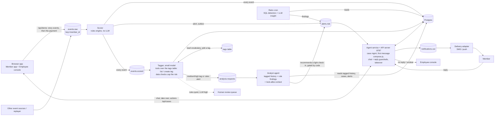
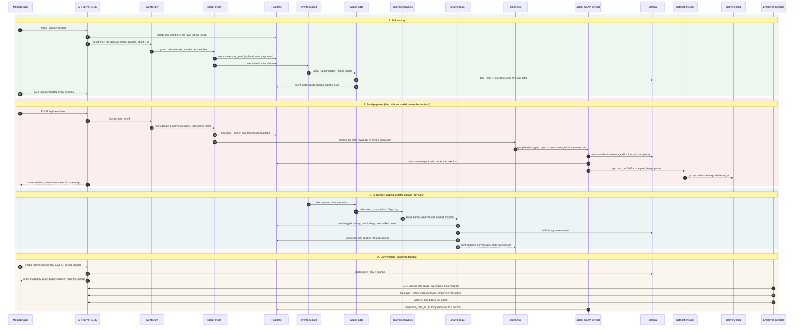

# Harbor backend architecture

Interactive version: run `task run`, open http://localhost:8787, then **Dev tools > Architecture** (diagram) and **Dev tools > Live pipeline** (the running system).

## Flow



## Flow, step by step

One story from start to conversation, in order. The app's **Dev tools > Architecture** page shows the same components and topics as one system diagram.



## Deployment: what runs where

What `task run` starts on one machine. Every box is a separate process or container; arrows are labelled with the topic, port or table they use.

```mermaid
flowchart TB
  classDef proc fill:#e8f3f6,stroke:#1d6f86,color:#0b2a33
  classDef topic fill:#fff4e0,stroke:#c98a1b,color:#3a2700
  classDef store fill:#eef0fb,stroke:#5560a8,color:#1b1f45
  classDef model fill:#f3ecfa,stroke:#7a4ca8,color:#2b1840
  classDef ui fill:#e9f7ec,stroke:#2f8a46,color:#0d2e16

  subgraph BROWSER["Browser"]
    UI_M["Member app<br/>(phone mock, Live AI or Guided)"]:::ui
    UI_E["Employee console<br/>(case, live events, take over)"]:::ui
    UI_D["Dev tools<br/>simulator, architecture, live pipeline"]:::ui
    UI_I["Model inspector<br/>inspector.html"]:::ui
  end

  subgraph HOST["Host machine: Node.js processes (backend/scripts/start-all.sh, logs and pids in backend/.logs/)"]
    direction TB
    subgraph API["agent-service.js  :8787  (the only HTTP port)"]
      direction TB
      HTTP["HTTP routes<br/>static app (harbor/http.js)<br/>/api/demo/start, send, state<br/>/api/console, /api/cases/:id/*<br/>/api/chat, /api/pipeline, /api/review<br/>/api/retro, /api/analyst/run, /api/status<br/>/api/traces (+ SSE stream)"]:::proc
      AGC["Agent consumer<br/>group harbor-agent, 2 partitions at once<br/>one open case per member, rate limit,<br/>first message via lib/compose.js"]:::proc
      DLV["Delivery adapter (stub)<br/>group harbor-delivery<br/>marks messages delivered"]:::proc
      TMR["Case timer, every 5 s<br/>no reply by due_at: escalate to a person"]:::proc
      CHAT["Chat agent harbor/agent.js<br/>prompt + shapeReply guardrails"]:::proc
    end
    SCORER["scorer.js<br/>group harbor-scorer, 3 partitions at once<br/>rules engine harbor/engine.js, no model<br/>member_state cache, outbox sweeper every 5 s"]:::proc
    TAGGER["tagger.js<br/>group harbor-tagger, 3 workers<br/>queues: live, then history, then catch-up<br/>catch-up sweep every 20 s"]:::proc
    ANALYST["analyst.js<br/>group harbor-analyst, 2 partitions at once<br/>one run per member, 5 min cooldown"]:::proc
    RETRO["retro.js (task retro or cron)<br/>SQL detectors + model insight"]:::proc
    TOOLS["One-off scripts<br/>replayer.js, seed.js, reset.js,<br/>redrive-dlq.js, smoke.js"]:::proc
    TRACE[("harbor/.traces/traces.jsonl<br/>every model call, all processes")]:::store
  end

  subgraph OLLAMA["Ollama  :11434  (local models; or ANTHROPIC / OPENAI keys)"]
    M14["qwen2.5:14b  HARBOR_MODEL<br/>chat, first message, analyst, retro"]:::model
    M3["qwen2.5:3b  HARBOR_TAG_MODEL<br/>tagger: tools + JSON schema"]:::model
  end

  subgraph DOCKER["Docker (Colima): docker compose project 'harbor'"]
    direction TB
    subgraph RP["harbor-redpanda (Kafka API)  localhost:19092  (internal :29092)"]
      T_RAW[["events.raw<br/>6 partitions, key member_id"]]:::topic
      T_SC[["events.scored<br/>6 partitions"]]:::topic
      T_AN[["analysis.requests<br/>6 partitions"]]:::topic
      T_AL[["alerts.risk<br/>6 partitions"]]:::topic
      T_OUT[["notifications.out<br/>6 partitions"]]:::topic
      T_DLQ[["events.dlq<br/>1 partition"]]:::topic
    end
    subgraph PGC["harbor-postgres (Postgres 16)  localhost:5439  volume harbor_pgdata"]
      PG_EV[("events, member_state, decisions")]:::store
      PG_AL[("alerts (outbox)")]:::store
      PG_TG[("event_notes, tags, review_queue")]:::store
      PG_AN[("analyses")]:::store
      PG_CS[("cases, case_alerts, messages")]:::store
      PG_RT[("retro_findings")]:::store
      PG_FB[("feedback, interactions<br/>ratings, verdicts, choices")]:::store
      PG_REF[("members, ground_truth,<br/>view v_rule_outcomes")]:::store
    end
  end

  UI_M -->|"pick story, send payment, chat"| HTTP
  UI_E -->|"console, take over, actions"| HTTP
  UI_D -->|"/api/pipeline, /api/cases"| HTTP
  UI_I -->|"/api/traces/stream"| HTTP

  HTTP -->|"story history, then the payment"| T_RAW
  HTTP -->|"manual analyst run"| T_AN
  HTTP <-->|"cases, messages, demo state"| PG_CS
  HTTP -->|"feedback, verdicts, interaction log"| PG_FB
  HTTP --> CHAT
  TOOLS -->|"bulk replay"| T_RAW

  T_RAW -->|"harbor-scorer"| SCORER
  SCORER -->|"event + decision + alert, one transaction"| PG_EV
  SCORER --> PG_AL
  SCORER -->|"alert (outbox publish)"| T_AL
  SCORER -->|"every event"| T_SC

  T_SC -->|"harbor-tagger"| TAGGER
  TAGGER -->|"tag, risk, note; rules quiet + high"| PG_TG
  TAGGER -->|"medium/high tag or rules alert"| T_AN
  TAGGER --> M3

  T_AN -->|"harbor-analyst"| ANALYST
  ANALYST -->|"reads history, writes verdict"| PG_AN
  ANALYST -->|"light check-in, if code allows"| T_AL
  ANALYST --> M14

  T_AL -->|"harbor-agent"| AGC
  AGC -->|"open or merge case"| PG_CS
  AGC -->|"first message"| T_OUT
  AGC --> M14
  CHAT --> M14
  T_OUT -->|"harbor-delivery"| DLV
  DLV -->|"delivered_at"| PG_CS
  TMR -->|"escalate"| PG_CS

  RETRO -->|"reads history"| PG_EV
  RETRO --> PG_RT
  RETRO -->|"follow-up finding"| T_AL
  RETRO --> M14

  SCORER -.->|"after 3 failures"| T_DLQ
  TAGGER -.-> T_DLQ
  ANALYST -.-> T_DLQ
  AGC -.-> T_DLQ
  T_DLQ -.->|"redrive-dlq.js"| TOOLS

  CHAT -.->|"trace"| TRACE
  TAGGER -.-> TRACE
  ANALYST -.-> TRACE
  AGC -.-> TRACE
  HTTP -.->|"read for inspector"| TRACE
```



**Inventory**

| Process / container | Started by | Listens on | Consumes (group) | Produces | Postgres | Model |
|---|---|---|---|---|---|---|
| `harbor-redpanda` | `docker compose up` (`task run`, `task infra`) | `localhost:19092` (Kafka API) | - | - | - | - |
| `harbor-postgres` | same | `localhost:5439` (volume `harbor_pgdata`, schema `init.sql`) | - | - | all tables | - |
| Ollama | `task run` starts it if needed | `localhost:11434` | - | - | - | serves both models |
| `agent-service.js` | `task run` (foreground) or `start-all.sh` | `:8787` (`AGENT_PORT`) app + API | `alerts.risk` (`harbor-agent`), `notifications.out` (`harbor-delivery`) | `events.raw` (demo), `notifications.out`, `analysis.requests` (manual) | cases, case_alerts, messages, alerts; reads everything for the console | 14B: first message, chat |
| `scorer.js` | `start-all.sh` | - | `events.raw` (`harbor-scorer`) | `alerts.risk`, `events.scored` | events, member_state, decisions, alerts | none |
| `tagger.js` | `start-all.sh` | - | `events.scored` (`harbor-tagger`) | `analysis.requests` | event_notes, tags, review_queue | 3B |
| `analyst.js` | `start-all.sh` | - | `analysis.requests` (`harbor-analyst`) | `alerts.risk` | analyses; reads events, notes, decisions, cases | 14B |
| `retro.js` | `task retro` / cron | - | - | `alerts.risk` | retro_findings; reads events, alerts, cases | 14B (one sentence) |
| `replayer.js` | `task replay` | - | - | `events.raw` | - | - |
| `redrive-dlq.js` | by hand | - | `events.dlq` (temporary group) | original topic | - | - |
| `harbor/server.js` | `task chat` (instead of the stack) | `:8787` app + `/api/chat` only | - | - | - | chat model |

Every consumer retries a failing message 3 times, then sends it to `events.dlq` so the partition keeps moving. All topics are keyed by `member_id`, so one member's events stay in order.

## Where the models sit, and what code enforces

Rules decide; models read and write; code checks every model output before it can matter. No model can hold, release or cancel a payment.

| Model | Job | What it gets | What code enforces afterwards |
|---|---|---|---|
| Scorer (no model) | Decide `none` / `confirm` / `hold` for each payment | Per-member state, the event | Everything: this is the only path to a hold. |
| Tagger, `qwen2.5:3b` (`services/tagger.js`) | Category (from the data dictionary) + tag + risk + note for every event | The event with its direction (incoming / outgoing), recent key events, the rules decision, the tag vocabulary | New tags must name a pattern (no amounts, dates or ids, not just the event type, no near-duplicates, size cap). Everyday events use the seed vocabulary only. Risk is capped at `medium` for everyday events, payments below the member's usual amount and the bank's own interventions, so only plausible items reach the human review queue. |
| Analyst, `HARBOR_MODEL` (`services/analyst.js`) | A staff-facing read of the member's recent tagged history; may recommend a light check-in | Tagged timeline, rule findings, the rules decision and any look-alike reason, hours since a password reset, open case / cooldown | It can only recommend: no open case, no rules alert, at least two medium/high tagged events, cooldown. If the rules judged a look-alike, risk is capped at `medium`. Its text is shown to staff only. |
| Composer, `HARBOR_MODEL` (`lib/compose.js`) | The first message to the member | A brief in second person: amount and method, held or light check, takeover facts, Planned Big Payment, the closing question | Repairs the brand name and inserts "Sound never asks..." if missing; rejects wrong paused / not-paused wording, a missing amount, more than one question, banned words, third-person text. Falls back to a fixed template after a rejection or `COMPOSE_TIMEOUT_MS`. |
| Chat agent, `HARBOR_MODEL` (`harbor/agent.js`) | Replies to the member and reads signals (who is pressuring them, did they verify...) | Member-safe reasons only, the conversation, the buttons on screen; Ollama output is constrained to a JSON schema of valid signal names | `shapeReply`: one question, no `[placeholders]`, the "officials never ask / hang up and call back" line when an official is named, the stop button when a takeover is denied, a private-conversation offer on red flags, no pointer to "This looks fine" until that button is shown. Keyword backstops may only add caution signals. A shared password or code replaces the reply with a fixed warning. Signals decide which buttons appear. |

Every model call is written to the trace log (`/api/traces`, Model inspector), including each guardrail that changed the output.

**Secrets are masked before anything is stored.** `harbor/redact.js` masks passwords, PINs, one-time codes, card and Social Security numbers in member messages, traces, feedback and the interaction log. The chat agent detects a shared secret on the raw text (to answer with the fixed warning), then masks it before the model sees it. When a first message falls back to the template, the reason (timeout, model error, or the check that failed) is stored with the message.

**Member-safe wording.** Rule reasons ("1.8x this member's usual amount") and the analyst's assessment are staff-facing. Members and the chat model only ever see `whyFor()` wording from `lib/compose.js`.

## Code map

| Path | What |
|---|---|
| `harbor/engine.js` | Rules engine, shared by the browser and the scorer. |
| `harbor/agent.js` | Chat agent: prompt, provider calls (`callModel`, Ollama schema output), guardrails. |
| `harbor/http.js` | Static files, JSON and body helpers shared by `harbor/server.js` (chat only) and the API server; one list of files that are never served. |
| `harbor/trace.js` | Model trace log and its endpoints. |
| `backend/lib/compose.js` | First message: brief, checks, template. |
| `backend/lib/llm.js` | JSON calls, tool loop, schema calls for the pipeline services, on top of `agent.callModel`. |
| `backend/lib/demo.js`, `events.js`, `kafka.js`, `db.js`, `config.js` | Demo story selection, event envelope, Kafka with retries and DLQ, Postgres and schema upgrades, settings. |
| `backend/services/*` | scorer, tagger, analyst, agent-service (API + agent + delivery stub), retro, replayer. |
| `backend/scripts/smoke.js` | End-to-end check of every story and route (`task smoke`). |
| `harbor/eval_agent.js` | Scripted conversations that score the chat agent and first messages (`task eval`). |

## How the demo drives it

`task run` starts Docker (Redpanda, Postgres), the scorer and tagger, then the **agent service, which is also the API server** on one port (8787) and serves the app.

| Browser action | API call | What happens |
|---|---|---|
| Pick a story / Reset | `POST /api/demo/start` | The member's old rows are deleted, an in-band `__reset` control event is published, then the account history is published to `events.raw` at a paced rate (about 3 s total) so the UI can show events being consumed. A newer start cancels an older stream. |
| Send payment | `POST /api/demo/send` | The trigger payment event is published. The scorer decides in a few ms, writes the decision and alert in one transaction; the agent composes the first message (LLM, template if it takes over 9 s). |
| Watching progress | `GET /api/demo/state` | Processed event count, the decision with its rule trace, the alert, the AI note, the case, messages and timings. |
| Employee console | `GET /api/console` | Latest case per member as a full view. |
| Member chat | `POST /api/cases/:id/reply` (Live AI) or `/log` (guided script) | Stored on the case; the guided script is mirrored, not delivered. |
| Harbor asks a person to join | `POST /api/cases/:id/join` | After each Live AI reply, code (not the model) checks whether a person should step in: the member pushes back or insists on sending (`member_insists`), sounds distressed or angry, asks for a person, denies a takeover, shares a code, shows 2+ red flags, or the chat passes 4 turns without a decision. The member is told a team member is coming; the console pings, opens that case with a banner and a Join chat button, and marks it in the queue. The request and the employee's response time go to the case log and the interaction log. |
| Employee takes over | `POST /api/cases/:id/takeover` | Case moves to `escalated_human`; the agent stops replying until the employee hands the chat back. Employee messages are stored with source `employee`. |
| Employee actions | `POST /api/cases/:id/action` | Recorded on the case log. |
| Feedback | `POST /api/feedback`, `GET /api/feedback` | Member rating 1-5 (5 = extremely helpful) when a conversation ends, employee rating 1-5 per case, both with optional text. Stored in `feedback` with the agent version and a snapshot of the conversation, signals and case, so it survives demo resets and can be analysed later. Shown under Dev tools > Live pipeline. |
| Close-out verdict | `POST /api/feedback` (`kind: verdict`) | The employee records what really happened: confirmed scam, legitimate or unsure, with money lost and recovered. Ratings measure the experience; verdicts measure whether Harbor was right. |
| FTC report | `POST /api/ftc/questions`, `POST /api/ftc/draft`, `GET /api/ftc` | After an employee records **Confirmed scam**, Harbor tells the member in the chat and asks how they want to report it. **Help me report it**: Harbor asks only what the case does not already answer (how it started, when, who, earlier payments, permission to share contact details), then the agent drafts the report **field for field in the order of reportfraud.ftc.gov** (its 10 categories word for word; Report details with payment yes/no, amount, how it started, the social app, the date as mm/dd/yyyy; Details about the scammer with company, first/last name, other info; Comments within 3,500 characters and without account numbers; About you), or of IdentityTheft.gov for a takeover. There is no public submission API, and the report is not submitted by a headless browser: the route for automatic reporting would be a data-sharing agreement with the FTC (Consumer Sentinel). Code fills every checkable fact; the model writes only the category and the member's story, and code rejects a story with an amount it was not given or without the payment amount (template otherwise). The employee reviews it and files it **with the member**. **I'll report it myself**: the member gets the link and a summary to paste. **Not now**: the link for later. Stored in `ftc_reports`. Nothing is submitted automatically: there is no official API, the report belongs to the member, and demo data is synthetic. |
| Interaction log | `POST /api/interactions` (batched), `GET /api/interactions` | What the member was offered and chose, time to choose, voice or typing, Live AI fallbacks, abandoned chats, and employee replies after a takeover (with the member and Harbor messages before them, as example replies). Each row records the tone and agent version. |

Each story keeps its own state in the browser, so switching stories never resets another one. The hosted GitHub Pages copy has no backend and runs the same rules in the browser instead.

## What changed from the first sketch, and why

| Original idea | What I built | Why |
|---|---|---|
| LLM tags every event, then decides alert | **Every event goes through the rules first, then a small model tags it, then it is stored.** Rules alone decide alerts (fast path); the tagger runs in parallel. | An alert must be fast (about 1 ms vs seconds per LLM call), repeatable and explainable. A small model (`qwen2.5:3b`, about 1 s per event, 4 in parallel, live events jump the queue) makes tagging every event affordable. A catch-up sweep tags anything left behind. |
| Fixed tag list | **A `tags` table the model can read and extend** (tool calls `list_tags`, `create_tag`, `tag_event`). | Patterns we did not foresee get a name. Code keeps it tidy: letters only, no near-duplicates, a size cap, and everyday events can only reuse existing tags. Category comes from the data dictionary, not the model. |
| Retro cron is the only deep look | **An analyst agent also runs on triggers** (rules alert, or a medium/high tag): it scans Postgres for the member's tagged history, builds context, and may recommend a light check-in. | Catches patterns between nightly runs. Code gates every start: no open case, no rules alert already covering it, at least two medium/high tagged events, a cooldown. It can only start a light check-in and never holds a payment. Its read is shown to the employee as context. |
| LLM output decides "risky" | LLM is **advisory**: it writes tags and notes. Rules quiet + LLM "high" goes to a **human review queue**, not to the member. | A hallucinating model must not be able to message or freeze a member. Disagreements are stored (`event_notes.disagrees`) and become tuning data. |
| Store only non-alerted events in Postgres | **Store every event** with its decision. | The retro job and case timelines need alerted events and their context too. |
| Alert straight to a queue | **Outbox**: the alert is written in the same transaction as the decision, then published; a sweeper re-sends any unpublished row. | Avoids the dual-write bug (committed but never published, or published but never committed). |
| One consumer chain | **Per-member ordering** (key = `member_id`), **idempotent** keys (`event_id`, `alert_id`), retries then a **dead-letter topic** with a redrive script. | Stateful rules need ordered events. Kafka is at-least-once, so replays must be harmless. A poison message must not block a partition. |
| LLM writes the first message freely | **`lib/compose.js`**: the model writes it from a brief, then code repairs what it safely can (brand name, the "Sound never asks" line) and checks the rest (amount, paused / not-paused wording, one closing question); otherwise the template is used. | A member-facing message must always carry the safety facts. Staff wording (rule reasons, the analyst's assessment) never reaches the member. |
| LLM chat replies go straight to the member | **Code shapes every reply** (`shapeReply`) and decides the buttons from the signals. | A model can forget the one line that matters ("officials never ask you to move money") or point to a button that is not on screen. Code guarantees both. |
| Small model's risk goes straight to review | **Data checks overrule it** (direction, member baseline, event category). | A 3B model rated incoming deposits and $20 payments "high"; the review queue was mostly noise. |
| Agent sends a message per alert | **One open case per member.** Further alerts join it; a rate limit applies (takeover is exempt); channel is chosen per case. | A takeover produced two alerts 8 minutes apart; the member must get one message. Takeover goes to the phone on file *before* the change. |
| Retro "looks for insights" | **SQL detectors find candidates; the LLM only writes the insight sentence.** Findings are deduped by key and re-enter the same `alerts.risk` topic. | Cheap, repeatable, auditable. Retro payments have already completed, so the agent switches to a follow-up, recovery-oriented tone. |
| Separate chat server and agent service | **One API server** serves the app, demo, case and chat endpoints and runs the agent. | One port to run and demo. Fewer moving parts. |
| Agent always owns the conversation | **Employee can take over** a chat and hand it back. | A person must be able to step in the moment a member needs one, with the full context. |
| (not in sketch) | `member_state` table, case timers, outcome view `v_rule_outcomes` | Restarts do not lose context. A member who never replies reaches a human. Rules can be measured against outcomes. |

## Topics

| Topic | Key | Producer | Consumer group |
|---|---|---|---|
| `events.raw` | member_id | API server (`/api/demo/*`), replayer, real sources | `harbor-scorer` |
| `events.scored` | member_id | scorer (every event) | `harbor-tagger` |
| `analysis.requests` | member_id | tagger (medium/high tag or rules alert) | `harbor-analyst` |
| `alerts.risk` | member_id | scorer, retro, analyst | `harbor-agent` |
| `notifications.out` | member_id | agent | `harbor-delivery` |
| `events.dlq` | consumer group | any consumer after 3 failures | `scripts/redrive-dlq.js` |

## Run it

```
cd backend
npm install
npm run up            # Redpanda (Kafka API, :19092) + Postgres (:5439); schema from init.sql
npm run seed
./scripts/start-all.sh                       # scorer, tagger, analyst, agent service (HARBOR_PROVIDER=ollama by default)
# bulk load (optional; the demo UI streams one member at a time via the API):
node services/replayer.js --members M1003,M1001,M1039,M1057,M1002,M1004 --rate 60
node services/retro.js --once --as-of 2026-10-05T00:00:00Z
./scripts/stop-all.sh && npm run down
```
Checks: `task test` (rules on all 118 members), `task smoke` (every story and route against the running stack), `task eval` (chat agent and first messages, `-- --repeat 3` to see variance). `task reset` also removes model-made tags; the seed vocabulary stays.
LLM provider is the same switch as the chat agent: `HARBOR_PROVIDER=ollama|anthropic|openai|mock`. The tagger uses a small model (`HARBOR_TAG_MODEL`, default `qwen2.5:3b`, pulled by `task run`); the analyst and the chat agent use `HARBOR_MODEL`. Native tool calling is Ollama-only; other providers fall back to one JSON call with the same vocabulary. With no provider the services still run: tags fall back to rules, messages fall back to templates.
Retro in production: `0 3 * * * cd /path/backend && node services/retro.js --once`. Locally "now" is the newest event time, so replayed data behaves like a live clock.

## Known gaps (honest list)

- Kafka runs as a single Redpanda node with replication 1. Production needs 3 brokers, auth and TLS.
- A 3B model makes weak calls sometimes (it can rate a takeover pattern "medium", or write a wrong note such as "$83 is 5.1x baseline"). That is why tags are advisory, risk is capped by data checks, and the analyst's actions are gated in code.
- The 14B analyst can misread time gaps ("shortly after" for 25 hours) even when given the number; look-alike risk is capped in code.
- One Ollama serves the tagger, analyst, composer and chat. `task run` sets `OLLAMA_NUM_PARALLEL=4` so requests to the same model no longer queue (measured: two 14B requests at once took 832 + 1,666 ms, the second waiting for the first). They still share one GPU, so under a tagger backlog the first message can exceed `COMPOSE_TIMEOUT_MS` (9 s) and the template is used. Production would give the member-facing model its own capacity.
- There is no automated browser test: `task smoke` covers the API, not the page.
- The tagger is slower than the replay (LLM-bound). That is the point of the split, but lag should be monitored; there is no alert on consumer lag yet.
- The scorer's in-memory state cache assumes one scorer instance per partition set. Scaling out relies on the consumer group's partition assignment plus the persisted `member_state`.
- Case timeout is wall-clock (`CASE_TIMEOUT_SEC`), while retro uses event time. Fine for a demo; unify before production.
- The demo's reset deletes a member's rows directly in Postgres; production would never do that.
- Messages are logged by a delivery stub, not sent. Swap `harbor-delivery` for a real SMS/push provider.
- Credentials are local dev defaults. No PII beyond synthetic data.
