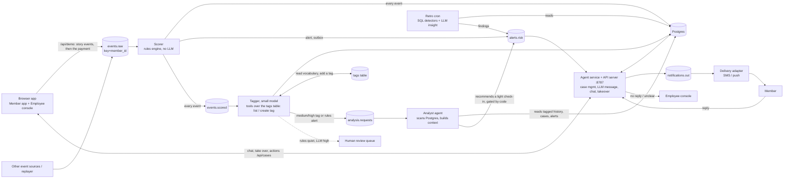

# Harbor backend architecture

Interactive version: run `task run`, open http://localhost:8787, then **Dev tools > Architecture** (diagram) and **Dev tools > Live pipeline** (the running system).

## Flow



## How the demo drives it

`task run` starts Docker (Redpanda, Postgres), the scorer and tagger, then the **agent service, which is also the API server** on one port (8787) and serves the app.

| Browser action | API call | What happens |
|---|---|---|
| Pick a story / Reset | `POST /api/demo/start` | The member's old rows are deleted, an in-band `__reset` control event is published, then the account history is published to `events.raw` at a paced rate (about 3 s total) so the UI can show events being consumed. A newer start cancels an older stream. |
| Send payment | `POST /api/demo/send` | The trigger payment event is published. The scorer decides in a few ms, writes the decision and alert in one transaction; the agent composes the first message (LLM, template if it takes over 9 s). |
| Watching progress | `GET /api/demo/state` | Processed event count, the decision with its rule trace, the alert, the AI note, the case, messages and timings. |
| Employee console | `GET /api/console` | Latest case per member as a full view. |
| Member chat | `POST /api/cases/:id/reply` (Live AI) or `/log` (guided script) | Stored on the case; the guided script is mirrored, not delivered. |
| Employee takes over | `POST /api/cases/:id/takeover` | Case moves to `escalated_human`; the agent stops replying until the employee hands the chat back. Employee messages are stored with source `employee`. |
| Employee actions | `POST /api/cases/:id/action` | Recorded on the case log. |

Each story keeps its own state in the browser, so switching stories never resets another one. The hosted GitHub Pages copy has no backend and runs the same rules in the browser instead.

## What changed from the first sketch, and why

| Original idea | What I built | Why |
|---|---|---|
| LLM tags every event, then decides alert | **Every event goes through the rules first, then a small model tags it, then it is stored.** Rules alone decide alerts (fast path); the tagger runs in parallel. | An alert must be fast (about 1 ms vs seconds per LLM call), repeatable and explainable. A small model (`qwen2.5:3b`, about 1 s per event, 4 in parallel, live events jump the queue) makes tagging every event affordable. A catch-up sweep tags anything left behind. |
| Fixed tag list | **A `tags` table the model can read and extend** (tool calls `list_tags`, `create_tag`, `tag_event`). | Patterns we did not foresee get a name. Code keeps it tidy: letters only, no near-duplicates, a size cap, and everyday events can only reuse existing tags. Category comes from the data dictionary, not the model. |
| Retro cron is the only deep look | **An analyst agent also runs on triggers** (rules alert, or a medium/high tag): it scans Postgres for the member's tagged history, builds context, and may recommend a light check-in. | Catches patterns between nightly runs. Code gates every start: no open case, no rules alert already covering it, at least two medium/high tagged events, a cooldown. It can only start a light check-in and never holds a payment. Its read is shown to the employee as context. |
| LLM output decides "risky" | LLM is **advisory**: it writes tags and notes. Rules quiet + LLM "high" goes to a **human review queue**, not to the member. | A hallucinating model must not be able to message or freeze a member. Disagreements are stored (`event_notes.disagrees`) and become tuning data. |
| Store only non-alerted events in Postgres | **Store every event** with its decision. | The retro job and case timelines need alerted events and their context too. |
| Alert straight to a queue | **Outbox**: the alert is written in the same transaction as the decision, then published; a sweeper re-sends any unpublished row. | Avoids the dual-write bug (committed but never published, or published but never committed). |
| One consumer chain | **Per-member ordering** (key = `member_id`), **idempotent** keys (`event_id`, `alert_id`), retries then a **dead-letter topic** with a redrive script. | Stateful rules need ordered events. Kafka is at-least-once, so replays must be harmless. A poison message must not block a partition. |
| Agent sends a message per alert | **One open case per member.** Further alerts join it; a rate limit applies (takeover is exempt); channel is chosen per case. | A takeover produced two alerts 8 minutes apart; the member must get one message. Takeover goes to the phone on file *before* the change. |
| Retro "looks for insights" | **SQL detectors find candidates; the LLM only writes the insight sentence.** Findings are deduped by key and re-enter the same `alerts.risk` topic. | Cheap, repeatable, auditable. Retro payments have already completed, so the agent switches to a follow-up, recovery-oriented tone. |
| Separate chat server and agent service | **One API server** serves the app, demo, case and chat endpoints and runs the agent. | One port to run and demo. Fewer moving parts. |
| Agent always owns the conversation | **Employee can take over** a chat and hand it back. | A person must be able to step in the moment a member needs one, with the full context. |
| (not in sketch) | `member_state` table, case timers, outcome view `v_rule_outcomes` | Restarts do not lose context. A member who never replies reaches a human. Rules can be measured against outcomes. |

## Topics

| Topic | Key | Producer | Consumer group |
|---|---|---|---|
| `events.raw` | member_id | API server (`/api/demo/*`), replayer, real sources | `harbor-scorer` |
| `events.scored` | member_id | scorer (every event) | `harbor-tagger` |
| `analysis.requests` | member_id | tagger (medium/high tag or rules alert) | `harbor-analyst` |
| `alerts.risk` | member_id | scorer, retro, analyst | `harbor-agent` |
| `notifications.out` | member_id | agent | `harbor-delivery` |
| `events.dlq` | consumer group | any consumer after 3 failures | `scripts/redrive-dlq.js` |

## Run it

```
cd backend
npm install
npm run up            # Redpanda (Kafka API, :19092) + Postgres (:5439); schema from init.sql
npm run seed
./scripts/start-all.sh                       # scorer, tagger, analyst, agent service (HARBOR_PROVIDER=ollama by default)
# bulk load (optional; the demo UI streams one member at a time via the API):
node services/replayer.js --members M1003,M1001,M1039,M1057,M1002,M1004 --rate 60
node services/retro.js --once --as-of 2026-10-05T00:00:00Z
./scripts/stop-all.sh && npm run down
```
LLM provider is the same switch as the chat agent: `HARBOR_PROVIDER=ollama|anthropic|openai|mock`. The tagger uses a small model (`HARBOR_TAG_MODEL`, default `qwen2.5:3b`, pulled by `task run`); the analyst and the chat agent use `HARBOR_MODEL`. Native tool calling is Ollama-only; other providers fall back to one JSON call with the same vocabulary. With no provider the services still run: tags fall back to rules, messages fall back to templates.
Retro in production: `0 3 * * * cd /path/backend && node services/retro.js --once`. Locally "now" is the newest event time, so replayed data behaves like a live clock.

## Known gaps (honest list)

- Kafka runs as a single Redpanda node with replication 1. Production needs 3 brokers, auth and TLS.
- A 3B model makes weak calls sometimes (it can rate a takeover pattern "medium", or create a redundant tag). That is why tags are advisory and the analyst's actions are gated in code.
- The tagger is slower than the replay (LLM-bound). That is the point of the split, but lag should be monitored; there is no alert on consumer lag yet.
- The scorer's in-memory state cache assumes one scorer instance per partition set. Scaling out relies on the consumer group's partition assignment plus the persisted `member_state`.
- Case timeout is wall-clock (`CASE_TIMEOUT_SEC`), while retro uses event time. Fine for a demo; unify before production.
- The demo's reset deletes a member's rows directly in Postgres; production would never do that.
- Messages are logged by a delivery stub, not sent. Swap `harbor-delivery` for a real SMS/push provider.
- Credentials are local dev defaults. No PII beyond synthetic data.
