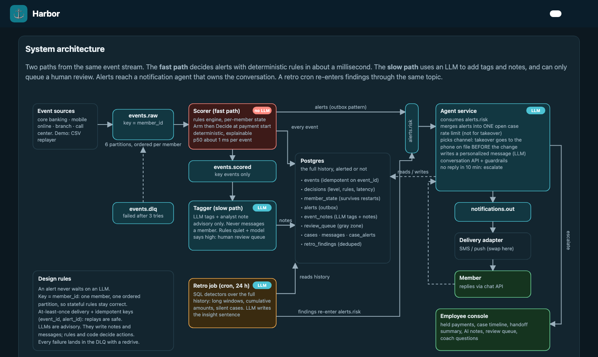
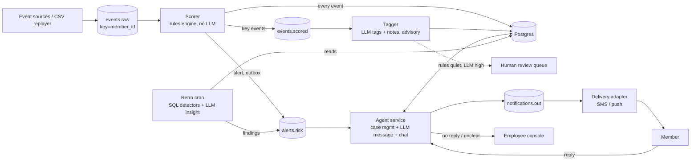

# Harbor backend architecture



Interactive version: open `harbor/index.html`, tab **Architecture** (diagram) and **Live pipeline** (the running system).

## Flow



## What changed from the first sketch, and why

| Original idea | What I built | Why |
|---|---|---|
| LLM tags every event, then decides alert | **Rules decide alerts (fast path). The LLM tags in a parallel slow path.** | An alert must be fast (about 1 ms here vs 3 s per LLM call), repeatable and explainable. 7,471 events x 3 s is over 6 hours on a local model. The LLM only sees "key" events, never card swipes or logins. |
| LLM output decides "risky" | LLM is **advisory**: it writes tags and notes. Rules quiet + LLM "high" goes to a **human review queue**, not to the member. | A hallucinating model must not be able to message or freeze a member. Disagreements are stored (`event_notes.disagrees`) and become tuning data. |
| Store only non-alerted events in Postgres | **Store every event** with its decision. | The retro job and case timelines need alerted events and their context too. |
| Alert straight to a queue | **Outbox**: the alert is written in the same transaction as the decision, then published; a sweeper re-sends any unpublished row. | Avoids the dual-write bug (committed but never published, or published but never committed). |
| One consumer chain | **Per-member ordering** (key = `member_id`), **idempotent** keys (`event_id`, `alert_id`), retries then a **dead-letter topic** with a redrive script. | Stateful rules need ordered events. Kafka is at-least-once, so replays must be harmless. A poison message must not block a partition. |
| Agent sends a message per alert | **One open case per member.** Further alerts join it; a rate limit applies (takeover is exempt); channel is chosen per case. | A takeover produced two alerts 8 minutes apart; the member must get one message. Takeover goes to the phone on file *before* the change. |
| Retro "looks for insights" | **SQL detectors find candidates; the LLM only writes the insight sentence.** Findings are deduped by key and re-enter the same `alerts.risk` topic. | Cheap, repeatable, auditable. Retro payments have already completed, so the agent switches to a follow-up, recovery-oriented tone. |
| (not in sketch) | `member_state` table, case timers, outcome view `v_rule_outcomes` | Restarts do not lose context. A member who never replies reaches a human. Rules can be measured against outcomes. |

## Topics

| Topic | Key | Producer | Consumer group |
|---|---|---|---|
| `events.raw` | member_id | demo UI (`/api/demo/*`), replayer, real sources | `harbor-scorer` |
| `events.scored` | member_id | scorer (key events only) | `harbor-tagger` |
| `alerts.risk` | member_id | scorer, retro | `harbor-agent` |
| `notifications.out` | member_id | agent | `harbor-delivery` |
| `events.dlq` | consumer group | any consumer after 3 failures | `scripts/redrive-dlq.js` |

## Run it

```
cd backend
npm install
npm run up            # Redpanda (Kafka API, :19092) + Postgres (:5439); schema from init.sql
npm run seed
./scripts/start-all.sh                       # scorer, tagger, agent service (HARBOR_PROVIDER=ollama by default)
# bulk load (optional; the demo UI streams one member at a time via the API):
node services/replayer.js --members M1003,M1001,M1039,M1057,M1002,M1004 --rate 60
node services/retro.js --once --as-of 2026-10-05T00:00:00Z
./scripts/stop-all.sh && npm run down
```
LLM provider is the same switch as the chat agent: `HARBOR_PROVIDER=ollama|anthropic|openai|mock`. With no provider the services still run: tags fall back to rules, messages fall back to templates.
Retro in production: `0 3 * * * cd /path/backend && node services/retro.js --once`. Locally "now" is the newest event time, so replayed data behaves like a live clock.

## Known gaps (honest list)

- Kafka runs as a single Redpanda node with replication 1. Production needs 3 brokers, auth and TLS.
- The tagger is slower than the replay (LLM-bound). That is the point of the split, but lag should be monitored; there is no alert on consumer lag yet.
- The scorer's in-memory state cache assumes one scorer instance per partition set. Scaling out relies on the consumer group's partition assignment plus the persisted `member_state`.
- Case timeout is wall-clock (`CASE_TIMEOUT_SEC`), while retro uses event time. Fine for a demo; unify before production.
- Messages are logged by a delivery stub, not sent. Swap `harbor-delivery` for a real SMS/push provider.
- Credentials are local dev defaults. No PII beyond synthetic data.
